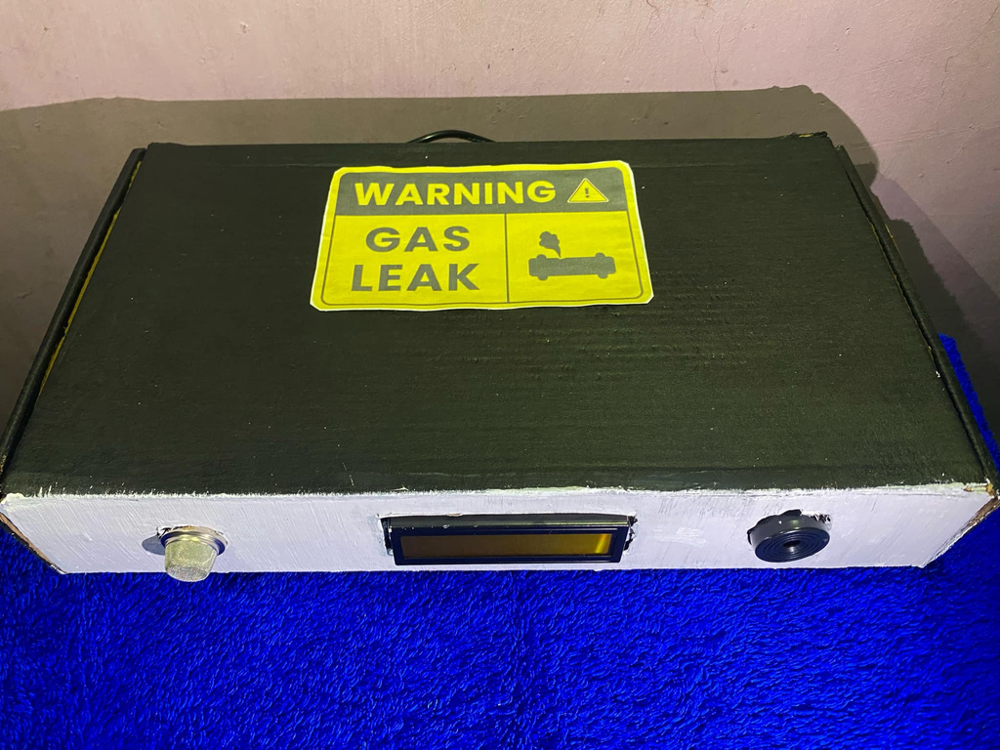
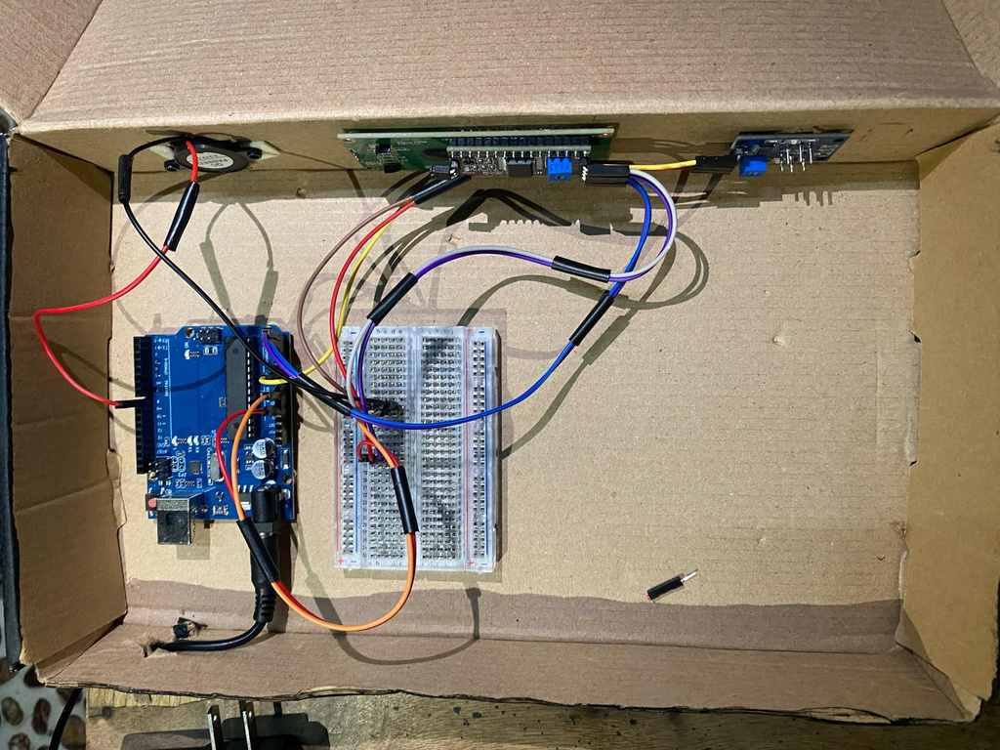

# Gas Leakage Alarm System (Arduino)

An Arduino device that detects gas leaks. When the MQ-5 sensor detects gas above the set level, the buzzer sounds an alarm and the LCD shows **"Gas Detected!"**.

> Team project for BSIT at Datamex College of Saint Adeline.

## Components

| Part | Purpose |
|---|---|
| Arduino Uno | The main board that runs the code |
| MQ-5 gas sensor | Detects gas in the air |
| 16x2 LCD (I2C) | Shows the gas level and the warning |
| Buzzer | Sounds the alarm |
| Breadboard and jumper wires | Connect all the parts |

## How it works

1. The MQ-5 sensor sends a gas reading to pin **A0**.
2. The Arduino shows the gas level on the LCD and the Serial Monitor.
3. If the gas level is **above 300**, the buzzer (pin **8**) turns on and the LCD shows "Gas Detected!".
4. If not, the buzzer stays off and the LCD shows "No Gas Detected".

## Source code

The code is in [`gas_leakage_alarm/gas_leakage_alarm.ino`](gas_leakage_alarm/gas_leakage_alarm.ino).

It needs the **LiquidCrystal_I2C** library (Arduino IDE: Sketch > Include Library > Manage Libraries).

## How we built it

1. Bought and checked all the materials.
2. Connected the parts on the breadboard and Arduino, with help from tutorials.
3. Installed the Arduino IDE and tested the code.
4. **Problem:** the code would not upload. After troubleshooting the settings, cable, and code, we found that the Arduino Uno was defective.
5. Rebuilt the system with a new Arduino Uno. It worked.

## What I learned

- How to read a sensor and control a buzzer and LCD with code
- How to use `if-else` to make decisions in a program
- How to troubleshoot one thing at a time to find the real problem
